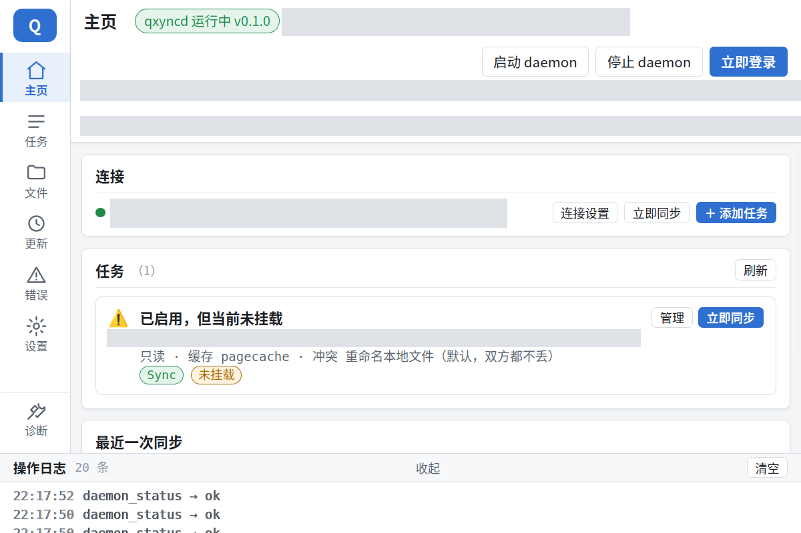
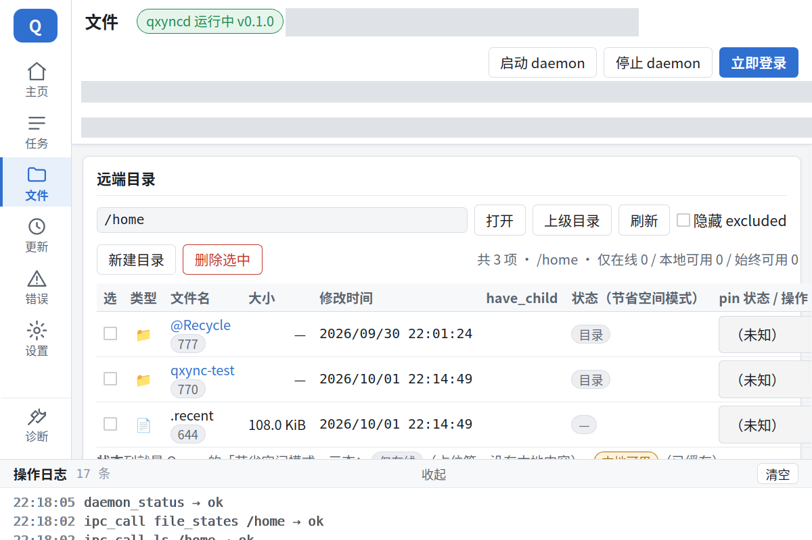
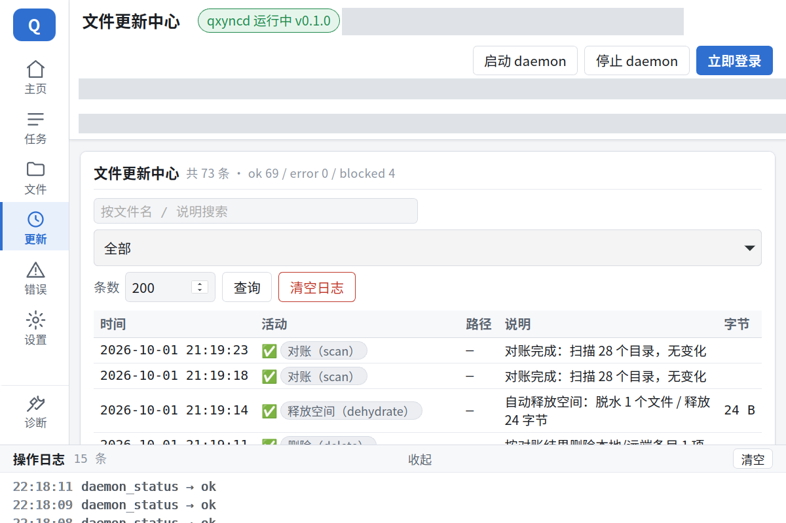
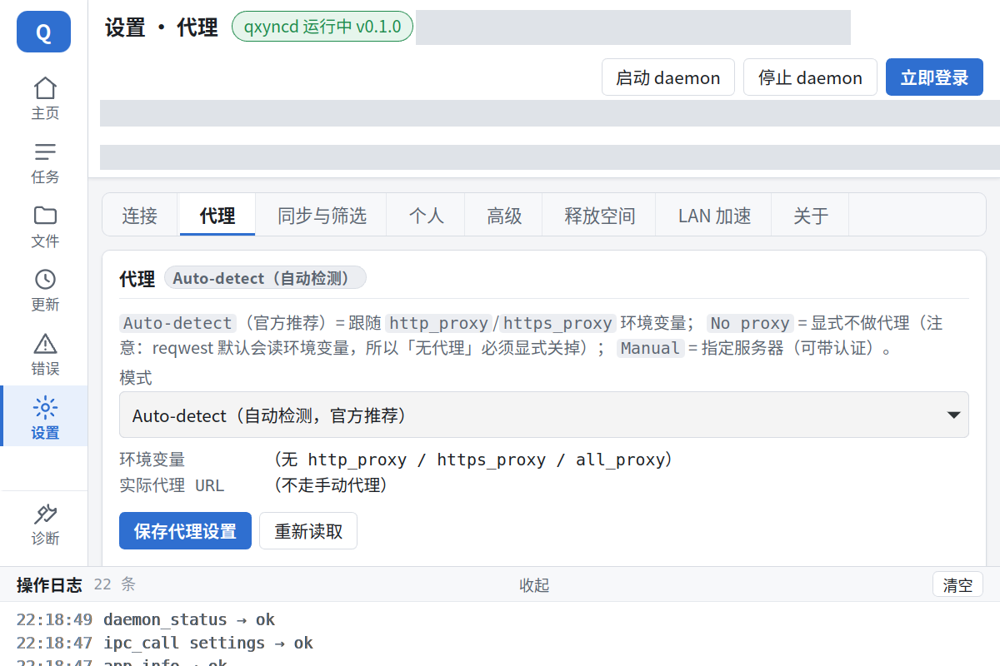

# qxync —— Linux 上的 QNAP Qsync 客户端（按需同步）

[](https://github.com/mlzxgzy/qxync/actions/workflows/ci.yml)
[](https://github.com/mlzxgzy/qxync/releases)
[](#许可证)
[](#安装)

**中文** · [English](README.en.md) · [下载](https://github.com/mlzxgzy/qxync/releases) · [变更日志](CHANGELOG.md) · [免责声明](DISCLAIMER.md)

用 Rust + FUSE 写的**第三方 QNAP Qsync 客户端**，核心是 **on-demand 按需同步**：
NAS 上的文件在本地只是一个「占位符」，`ls -l` 显示真实大小却**不下载内容**；
读到哪一块才取哪一块，不需要的本地内容可以**脱水**换回磁盘空间。

安装后你会得到三个程序：`qxync`（命令行）、`qxyncd`（常驻守护进程）、`qxync-gui`（桌面 GUI）。

> ⚠️ 只用于**你自己拥有或已获明确授权**的 QNAP NAS。本项目与 QNAP Systems, Inc. 无关，
> 不分发任何 QNAP 二进制或安装包，详见 [免责声明](DISCLAIMER.md)。
> 它会**读写你 NAS 上的真实文件**，请先在测试目录验证，再用于重要数据。

## 功能

- **按需同步**：占位符 + 128 KiB 区间按需下载；`head -c 100 big.bin` 只取需要的那一块，不是整个文件
- **缓存优先**：已经下载的内容直接复用；目录列表用本地快照，`ls` 不用每次都等网络
- **长期挂载不掉线**：登录会话过期会自动重登并原地重试，不用手动重挂
- **离线可用**：断网时已缓存内容照常读写；本地改动（含新建目录、改名、删除、
  `touch`）进持久化缓冲区，联网后按顺序统一同步，不再「等 10 秒就放弃」
- **读写挂载**：`--rw` 后本地改动经上传队列推回 NAS；写前补齐未取回的区间，不会把远端内容清零
- **释放空间**：按闲置时间 / 缓存上限自动脱水，也可以手动 `qxync dehydrate`
- **冲突处理**：两端都改时生成冲突副本；可逐文件选择保留本地、保留 NAS 或两份都留
- **选择性同步**：gitignore 风格的 `exclude` 规则 + 内置临时文件过滤
- **共享文件夹**：家目录和 NAS 上登记的同步文件夹都能挂；能不能写入由 NAS 决定
- **多台 NAS**：每条连接一个独立 daemon，可同时挂载和同步多台 NAS
- **两步验证**：支持 QNAP 两步验证里的 TOTP（authenticator app）
- **LAN 直连**：同一局域网内 qxync↔qxync 直接传数据，失败自动回落到 NAS
- **桌面 GUI**：主页 / 任务 / 文件 / 更新 / 错误 / 设置 / 诊断，托盘、通知、开机自启

## 截图

> 截图为脱敏后的界面（真实 NAS 地址与本机路径已涂抹）。

| 主页 | 文件 |
|---|---|
|  |  |

| 文件更新中心 | 设置 · 代理 |
|---|---|
|  |  |

## 安装

从 [Releases](https://github.com/mlzxgzy/qxync/releases) 下载预编译产物，或从源码构建。
预编译产物是 **x86_64 Linux**，要求 **glibc ≥ 2.35**；每个 Release 都带 `SHA256SUMS` 可校验。
NAS 侧需要已安装并启用 **Qsync**（QPKG），并在 QTS 里打开 Qsync 服务（默认端口 `9834`）。

### Arch Linux

```bash
# 下载 Release 里的 qxync-bin-<版本>-1-x86_64.pkg.tar.zst
sudo pacman -U qxync-bin-<版本>-1-x86_64.pkg.tar.zst
```

包内包含三个程序、桌面项、图标和 systemd user 单元。
仓库里也带一份 AUR 包定义（[`packaging/arch/`](packaging/arch/)）：在 `packaging/arch/` 下先
`updpkgsums` 回填 Release 产物的校验和，再 `makepkg -si`（详见该目录的 README）。

### Debian / Ubuntu

Release 里只有一个 `.deb`，**Debian 与 Ubuntu 通用**（amd64），适用发行版见下表：

| 下载这个 | 适用发行版 |
|---|---|
| `qxync_<版本>-1_amd64.deb` | Debian 12 / 13、Ubuntu 22.04 / 24.04 / 26.04 |

```bash
sudo apt install ./qxync_<版本>-1_amd64.deb
```

包里的东西与 Release 产物同源 —— 同一份 tar.gz 的三个二进制，加桌面项 / 图标 /
systemd user 单元 / 文档；在 `ubuntu:22.04` 容器里打包，`Depends` 用 `dpkg-shlibdeps`
对三个二进制实测、再手工补 `fuse3`。`apt install ./<文件>.deb` 会自动从你配置的 apt
源装齐依赖；习惯 `dpkg -i` 的话，装完再补一句 `sudo apt-get -f install` 把缺的依赖补齐即可。
依赖都是 Debian / Ubuntu 官方仓库里的标准包（GTK 3、WebKitGTK 4.1、libsoup 3、FUSE 3 等），
**国内清华、阿里等镜像源都有** —— 我们的打包与 CI 实装验证就是用清华源跑的。

CI 在干净的 `debian:12` / `debian:13` / `ubuntu:22.04` / `ubuntu:24.04` / `ubuntu:26.04`
容器里各 `apt install` 实装并跑过（`qxync --version` 正确、`ldd` 无 `not found`、
`qxync-gui --self-test` 有 JSON 输出；新版发行版把 GTK 3 改名成 `libgtk-3-0t64`，它带着
`Provides: libgtk-3-0 (= 版本)`，所以带版本下限的依赖照样满足）。包里有 systemd user 单元，
装完可以直接启用：

```bash
systemctl --user enable --now qxyncd
```

和 Release 产物一样**有意不 strip**（用户报 bug 时回溯才可读），装完约 190 MB。依赖清单、
打包方式与 lintian 预期告警等细节见 [`packaging/debian/README.md`](packaging/debian/README.md)。

**从旧包升级**：以前装过 `qxync_<旧版本>-1~deb12_amd64.deb` / `qxync_<旧版本>-1~ubuntu22.04_amd64.deb`
的，直接 `sudo apt install ./qxync_<版本>-1_amd64.deb` 即可 —— 按 dpkg 版本序 `<版本>-1` 大于
`<旧版本>-1~deb12`（`~` 排在空串之前），apt 会正常升级；想先确认可以跑
`dpkg --compare-versions <版本>-1 gt <旧版本>-1~deb12 && echo newer`。

### 其它 x86_64 Linux

```bash
# 下载 Release 里的 qxync-<版本>-x86_64-unknown-linux-gnu.tar.gz
tar xzf qxync-<版本>-x86_64-unknown-linux-gnu.tar.gz
cd qxync-<版本>-x86_64-unknown-linux-gnu
install -Dm755 qxync qxyncd qxync-gui ~/.local/bin/
```

包内还有 `qxync.desktop`、图标和 systemd 单元。注意 systemd 单元里的 `ExecStart` 假设二进制在
`/usr/bin`（发行版包的布局）；如果你把程序装到 `~/.local/bin`，要么把单元里的 `ExecStart` 改成
实际路径，要么不用单元、直接 `qxync daemon start`。
三个程序放在同一目录即可：GUI 会先找自己旁边的 `qxyncd`，找不到再退回 `PATH`。

运行时依赖：

- **挂载**需要 FUSE 3：`/dev/fuse` + `fusermount3`（装 `fuse3` 包）
- **GUI** 需要 WebKitGTK 4.1 与 GTK 3 运行库
  （Debian/Ubuntu：`libwebkit2gtk-4.1-0` + `libgtk-3-0`）

### 从源码构建

依赖 **Rust 1.90+**、FUSE 3；构建 GUI 还需要 WebKitGTK 4.1 / GTK 3 的开发包
（Debian/Ubuntu：`libwebkit2gtk-4.1-dev` + `libgtk-3-dev`）。

```bash
git clone https://github.com/mlzxgzy/qxync.git
cd qxync
cargo build --release --workspace
# 产物：target/release/{qxync,qxyncd,qxync-gui}
```

前端是 `crates/qxync-gui/ui/` 下的零依赖静态文件，**不需要 npm / 打包器**；
改了前端要重新 `cargo build`（资源在编译期嵌入）。需要 AppImage 时可用 Tauri CLI 打包，
`tauri.conf.json` 里已配好 targets；要本地打 Debian / Ubuntu 的 `.deb`，用仓库里的 debian
打包脚本，方法见 [`packaging/debian/README.md`](packaging/debian/README.md)。

## 快速开始

### 1. 登录 NAS

```bash
QXNYC_PASSWORD='<口令>' qxync login --host <NAS地址> --user <用户名> --insecure
```

- `--insecure` = 接受 QTS 的**自签证书**；NAS 用的是受信任证书时去掉它。
- 端口默认 `9834`（QTS 里改过的话用 `--port` 指定）。
- 口令用 `QXNYC_PASSWORD` 环境变量传，避免写进 shell 历史；登录后凭据保存在
  `~/.config/qxync/credentials.json`（`0600`；非 `default` 连接在
  `~/.config/qxync/links/<id>.credentials.json`）。
- 账号开了**两步验证**：加 `--otp-secret '<TOTP 密钥>'`（保存后 daemon 每次重登自动算码，
  推荐），或 `--otp-code <6 位验证码>`（只用于本次登录，不保存）。

### 2. 启动守护进程

装了发行版包（Arch / Debian / Ubuntu，或二进制在 `/usr/bin` 且自己装了 systemd 单元）时推荐用 user 单元：

```bash
systemctl --user enable --now qxyncd
journalctl --user -u qxyncd -f        # 看日志
sudo loginctl enable-linger "$USER"   # 可选：不登录也常驻（开机就起）
```

没有 systemd 时用 CLI：

```bash
qxync daemon start
```

> 两条路别同时用：用了 systemd 单元之后，就不要再 `qxync daemon start` / `stop` 管它。

多台 NAS：每条连接一个独立 daemon。`default` 之外的连接用模板单元
`qxyncd@<link_id>`（`<link_id>` 对应 `~/.config/qxync/links/<id>.json`，例如
`systemctl --user enable --now qxyncd@nas2`），或者 `qxync daemon start --all`；
`qxync links` 可以查看所有连接及其 daemon / 登录状态。

### 3. 挂载

```bash
mkdir -p ~/qxync-mnt
qxync mount ~/qxync-mnt --remote /home          # 只读（默认）
# 需要写回时改用（二选一）：
qxync mount ~/qxync-mnt --remote /home --rw     # 读写
```

挂载点里直接就是那个 NAS 文件夹的内容；**一个挂载点 = 一个 NAS 文件夹**
（要同步多个文件夹就建多个挂载点 / 任务）。

```bash
ls -l ~/qxync-mnt/qxync-test              # 真实大小，尚未下载
cat ~/qxync-mnt/qxync-test/hello.txt      # 首次读才按需下载，只取需要的区间
getfattr -n user.qxync.state ~/qxync-mnt/qxync-test/hello.txt   # placeholder / partial / hydrated
qxync dehydrate --path /home/qxync-test/big.bin                 # 脱水，回收本地空间
qxync umount ~/qxync-mnt
```

### 4. 桌面 GUI

```bash
qxync-gui
```

首次打开：在 **设置 → 连接** 填 NAS 地址、账号和口令并登录，然后点顶部「启动 daemon」。
已经用 systemd 启动 daemon 的话，这一步不需要再做。

### 5. 常用命令

| 命令 | 作用 |
|---|---|
| `qxync status` | 会话、服务端、游标、水合统计与挂载状态 |
| `qxync ls /home` | 列 NAS 目录 |
| `qxync mount ~/qxync-mnt --remote /home --rw` | 挂载（`--rw` 读写） |
| `qxync umount ~/qxync-mnt` | 卸载 |
| `qxync sync --once` | 立即跑一轮变更发现 |
| `qxync dehydrate --path <远端路径>` | 脱水，释放本地空间 |
| `qxync space --now` | 按当前策略立即释放空间 |
| `qxync task list` / `task pause <id>` / `task resume <id>` | 查看 / 暂停 / 继续同步任务 |
| `qxync journal --level error` | 同步日志 / 错误列表 |
| `qxync conflicts --resolve <id> --as keep_local\|keep_remote\|keep_both` | 处理冲突 |
| `qxync file-states <远端目录>` | 文件三态：仅在线 / 本地可用 / 始终可用 |
| `qxync settings` / `settings --set k=v` | 查看 / 修改设置（代理、自动释放空间等） |
| `qxync links` | 列出所有 NAS 连接（含各自 daemon / 登录状态） |
| `qxync peer status\|pair\|ping\|events\|fetch` | LAN 对等（需在连接配置里开启 `peer_listen`） |
| `qxync purge --task <id>` | 删除任务及其本地数据（默认只预览，加 `--yes` 才执行） |

全部子命令见 `qxync --help`；GUI 与 CLI 共用同一个 daemon。

## 升级

换掉二进制后**重启 daemon**（已经在跑的进程不会自动变）：

```bash
systemctl --user restart qxyncd       # 用了 systemd 单元
# 没有 systemd 时：
qxync daemon stop && qxync daemon start
```

`qxync daemon stop` 停止前会检查挂载点有没有被别的进程占用（在挂载点里打开了文件、
或者 `cd` 进去了）：有的话会列出 `pid / 程序 / 路径` 并**拒绝停止**，关掉这些程序后
再停；确实要硬停就加 `--force`（挂载点里打开着的文件会立刻失效）。`qxync umount`
走同一套检查。

从 0.1.x（原名 `qsync`）或 0.2.x（多根挂载）升级的破坏性变更见 [CHANGELOG](CHANGELOG.md)。

## 已知限制

- **只支持 Linux**：依赖 FUSE 与 `/proc` 语义，不支持 Windows / macOS。
- **真机验证范围有限**：只在 **QNAP TS-464C / QTS 5.2.9 / Qsync QPKG 5.0.0.7** 上做过完整验证，
  其它型号 / 固件可能有未覆盖的行为差异。
- **只支持本地账号直连**：不做 QID / myQNAPcloud 云账号登录。
- **一个挂载点 = 一个 NAS 文件夹**：多个文件夹请建多个任务。
- **多台 NAS 时的边界**：同一台 NAS 上的两条连接不要同时双向同步同一个远端目录
  （各自有独立 baseline，会互相把对方的改动当成自己的）。
- **两步验证只支持 TOTP**（authenticator app）：安全问题、邮件验证码、二维码 / 设备批准都没有实现；
  TOTP 密钥和口令一样明文保存在 `0600` 凭据文件里（keyring 支持是后续工作）。
- **托盘图标需要支持 SNI 的桌面环境**：Plasma、Xfce（statusnotifier 插件）、waybar、polybar、
  LXQt、Cinnamon、GNOME + AppIndicator 扩展都行；IceWM / Fluxbox / Openbox+tray / 裸 GNOME /
  老式 Xfce·MATE 面板（只有 XEmbed）不显示托盘图标
  （可装 [`snixembed`](https://sr.ht/~steef/snixembed/) 桥接老式托盘）。
  托盘不可见时关窗口就是真关，不会把窗口藏进没人画的托盘里。
- **界面目前只有中文**：`en` 文案表只覆盖两步验证相关的几条，其余界面仍是中文。
- **挂载点内没有回收站**：桌面环境的「移到回收站」会被拒绝，删除就是真删（远端由后台队列推送，
  并有批量删除熔断保护）。
- **与官方客户端不互通**：官方客户端的 WebSocket 二进制通道没有还原，LAN 加速是 qxync 之间的
  自研协议，失败会自动回落到 NAS。

## 安全与隐私

- **不采集、不上报任何遥测**，只连接你配置的 NAS 和（可选的）LAN 对端。
- **不写 NAS 的设备列表、不做设备注册、不修改 NAS 侧任何配置。**
- 凭据保存在 `~/.config/qxync/credentials.json`（`0600`，非 `default` 连接在 `links/<id>.credentials.json`），
  IPC socket 目录 `0700`。
  配置、状态库、缓存与日志分别在 `~/.config/qxync`、`~/.local/share/qxync`、`~/.local/state/qxync`；
  `qxync purge --all` 可以把本机数据一起清掉（不碰 NAS 和挂载点里的文件）。
- LAN 对等是**局域网内明文 TCP**，建议只在可信网络里开启。
- 发现安全问题请**不要开公开 Issue**，见 [SECURITY.md](SECURITY.md)。

## 参与贡献

Bug 报告、协议实测更正、代码 PR、界面翻译都欢迎，见 [CONTRIBUTING.md](CONTRIBUTING.md)。
动手前请先读其中的[两条铁则](CONTRIBUTING.md#4-两条铁则复审必查) —— 它们关乎数据完整性，
任何改动都不许违反。

## 许可证

本项目**原创代码**以 **MIT OR Apache-2.0** 双许可发布，任选其一：
[LICENSE-MIT](LICENSE-MIT) / [LICENSE-APACHE](LICENSE-APACHE)。

该许可只覆盖本仓库的原创部分；QNAP、Qsync、myQNAPcloud、QID 等名称与标识是
QNAP Systems, Inc. 的商标或注册商标，详见 [DISCLAIMER.md](DISCLAIMER.md)。

设计与验收记录在 [`docs/`](docs/)。
