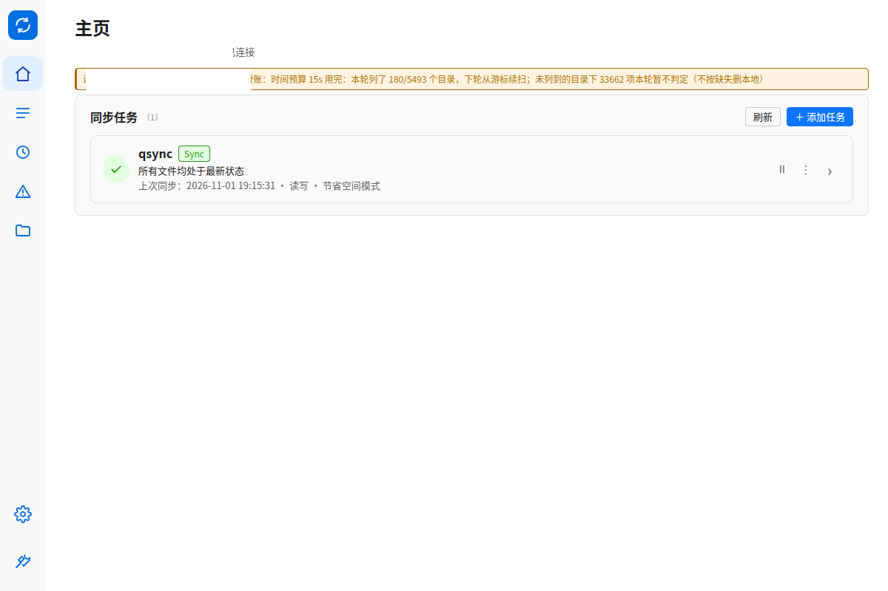
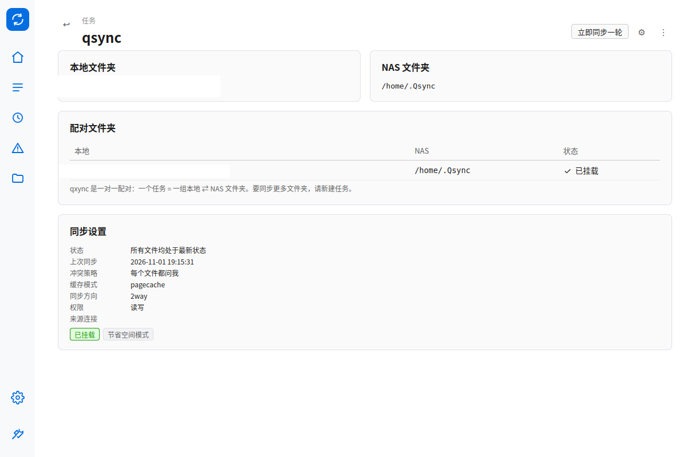
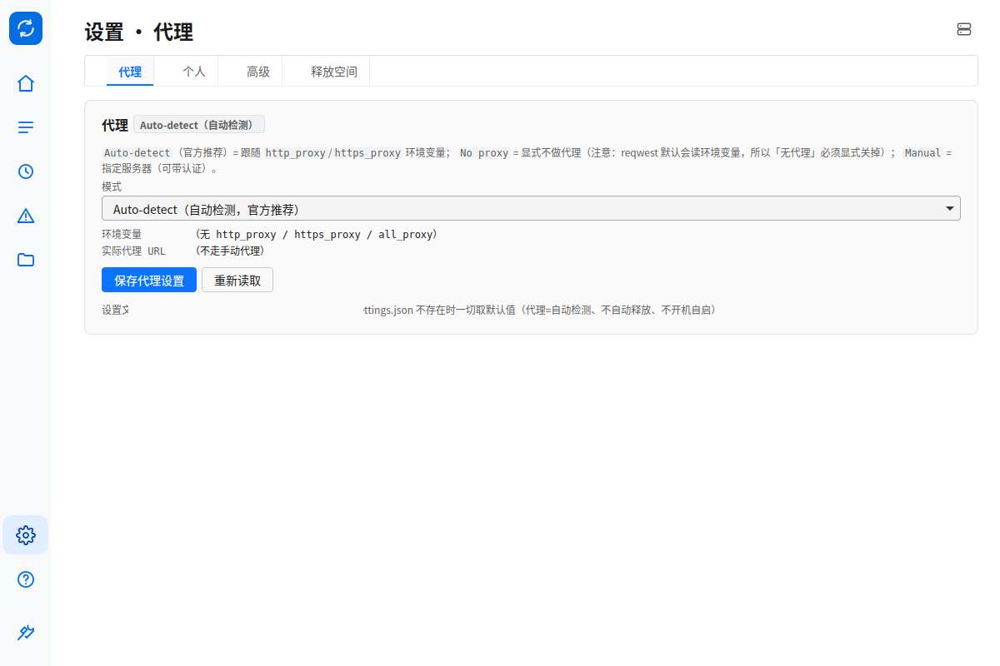
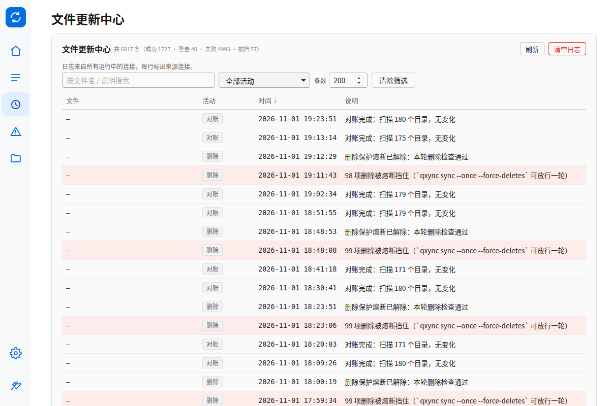

# v0.9.0 —— 桌面界面全面贴合 Qsync Client 6（产品级）

> 发布日期：2026-11-01
> 上一版：[v0.8.3](发布说明-v0.8.3.md)（两步验证登录对齐官方流程）
>
> **纯界面版**：只改 GUI（HTML/CSS/JS + 托盘菜单），**无同步语义变更、无 IPC 字段变更、
> 无配置/状态库格式变更**；升级换二进制即可，已有连接、任务、缓存全部照旧。

## 一句话

```text
升级后：
  → 左栏是 61px 纯图标（可开文字）、顶栏只剩页面标题和一行安静连接状态
  → 主页/任务是官方式平铺任务卡，点进去有任务详情页（本地/NAS 双卡 + 文件夹对）
  → 更新中心四列 + 排序/筛选，错误独立成页、按任务分组、可定位/复制/看日志
  → 设置只剩 4 个 tab；连接管理在右上角 NAS 菜单，关于在左栏 ⓘ
  → 分享是诚实占位页（无 Qsync Central 分享 API），首次启动有三步引导
```

## 一、为什么做

用户原话：

> 「调研一下 qsync client 的界面，我想将界面全面贴合 qsync，给个报告」

先交付了证据化调研：[调研报告](调研-Qsync-Client-6界面全面贴合报告.md)（官方教程 1× 截图逐屏
度量字号/间距/颜色/文案 + 与当前界面的逐项差异）与 [67 条工作项清单](贴合Qsync6-工作项清单.md)。
确认口径为 **D1 产品级贴合**（版式/层级/密度/术语对齐，不做像素复刻、不抄官方图标与插图），
随后按 P0 → P1 → P2 → P3 四批落地。

## 二、界面变化

### 2.1 外壳（P0）

| 以前 | 现在 |
|---|---|
| 左栏带文字、宽、选中靠背景块 | 61px 纯图标 + 内容组/底部组 + 选中药丸；tooltip；设置里可开「显示导航文字」 |
| 顶栏塞满 pid、uptime、socket、启停、登录 | 只留 24px 页面标题 + 一行「主机 · 已连接」；工程信息与运行控制全部进「诊断 → 运行控制」 |
| 操作日志常驻抢高度 | 默认收起，需要时再拉 |
| 间距/圆角/字重随手写 | Qsync 6 的 token 化间距/圆角/控件密度（`ui_spec.qs6_fit` 守） |

### 2.2 主页 / 任务（P1）

- 平铺任务卡：状态圆 + 任务名 + `Sync` 角标 + 上次同步**绝对时间** + 暂停 / ⋮ / ›；
- 单连接不再显示分组标题；多连接按连接分组；
- 点卡片进**任务详情页**：`↩ 任务`、本地文件夹卡 / NAS 文件夹卡、一对一文件夹对表、
  同步设置键值；齿轮打开「同步设置」弹窗（冲突策略等）；
- 创建任务：先选类型（同步任务可选；备份任务置灰并说明没有备份引擎）→ 同步任务表单；
  ID / 本地路径 / 缓存目录 / 方向 / 排除规则收进「高级」折叠，不删能力。

### 2.3 更新中心 / 错误（P2）

- 文件更新中心：文件 / 活动 / 时间 / 说明四列；时间与活动可排序；搜索、活动筛选、清除筛选；
- 活动名去技术（`qbox_get_max_log` 之类只留 tooltip 的原始 kind）；
- 错误列表独立成页、按任务分组；行操作「定位 / 复制路径 / 日志」；连接级错误单独一组。

### 2.4 设置 / 文件（P2）

- 设置收成 4 个 tab：代理 / 个人 / 高级 / 释放空间；
- 同步筛选、日志轮转、LAN 同步收进「高级」折叠；危险区留在「高级」底部；
- 连接管理进右上角 NAS 图标菜单（添加 / 管理 / 连接测试）；关于进左栏 ⓘ；
- 文件目录表列对齐：名称 / 类型 / 大小 / 修改时间 / 状态 / 操作；
  三态（仅在线 / 本地可用 / 始终可用）与同步维度压成单图标 + tooltip，pin 选择进 ⋯ 菜单。

### 2.5 打磨（P3）

- **分享中心**：官方第 4 个内容图标位；没有 Qsync Central 分享 API，所以做诚实占位
  （一句说明 + File Station 深链），不做点进去空白的页面；
- **帮助菜单**：关于 / 快速入门 / 新增功能 / 开源声明 / 在线文档；关于页只留版本、许可、
  运行概览，路径/socket/日志目录在「诊断 → 状态」；
- **首次引导**：没有任何连接的新用户首次启动出三步引导（连接 NAS → 建任务 → 开始使用），可跳过；
- **托盘菜单**：打开主窗口 / 立即同步 / 暂停 / 设置 / 关于 / 退出。

## 三、截图

| 主页（任务卡） | 任务详情 |
|---|---|
|  |  |

| 设置 · 代理 | 文件更新中心 |
|---|---|
|  |  |

更多逐屏截图与官方并排对比见 [验收目录](验收-Qsync6-96dpi/README.md) 与
[并排对比](验收-Qsync6-96dpi/并排对比.md)。

## 四、诚实边界（没有为了「像官方」而说谎）

- 「始终可用」仍然只是 **pin 标记**，不等于内容已在本地；tooltip 同时给空间三态与同步状态；
- 「立即同步」仍然只触发一轮轮询，不是强制全量扫描；没有真实百分比进度就不画进度条；
- 「暂停」仍是卸载挂载点（后端语义），文案按暂停展示；
- 自动更新置灰并写明原因（源码分发，没有更新通道），不做一个点了没反应的开关；
- LAN 同步是 qxync 自研协议，与官方 Windows 客户端不互通，界面明确写「同一账号的 qxync 设备」；
- 不引入官方图标/插图/字体：自绘线性图标 + 系统 CJK 字体。

## 五、没做（按确认口径）

| 项 | 原因 |
|---|---|
| 英文 UI | 需补 100+ 英文键；语言下拉暂只列简体中文 |
| 错误重试 | 需要 daemon IPC（不在本次范围） |
| 任务级筛选器 | 需要 link 级筛选下沉到 task（后端） |
| 通知点击跳转 | Linux 通知插件不暴露点击回调；错误页已有定位/复制/日志入口 |
| 自绘标题栏 | Linux CSD 风险高，官方也是原生标题栏 |
| 备份 / 恢复 / 版本 / 缩略图 / USB | 官方 6.0 旗舰能力，qxync 定位 Linux 按需同步 |

## 六、验证

| 项 | 结果 |
|---|---|
| `cargo build --release --locked` | Release 流水线负责；本地 `cargo check` 通过 |
| `qxync-gui --self-test` | `ok=true`，`ui_spec.ok=true`（含 `qs6_fit`、i18n、空态、a11y、purge 接线） |
| `xtask/tests/gui-matrix.sh`（自动 96dpi） | **165/165** |
| `xtask/tests/gui-purge.sh` | **37/37** |
| 版本一致性守卫 | `python3 xtask/release/check-version.py v0.9.0` → 四处一致 |

## 七、升级须知

- 纯 GUI 变更：不需要迁移配置、不需要重建缓存、不需要重新登录；
- 若你之前用 `QXNYC_GUI_TAB` 做深链，旧值全部继续可用（`status|mounts|sync|connect|files`
  以及 `settings:<分区>`）；`connect`/`about` 现在打开对应弹窗，`sync|log|lan` 打开「高级」里的对应折叠；
- 窗口尺寸/DPI 行为未变；96dpi 基线截图见验收目录。

## 八、如果新界面不合口味

GUI 是纯前端资源（编译进二进制），回退到 v0.8.3 即恢复旧界面；数据与配置向后兼容，
不需要任何回滚操作。
