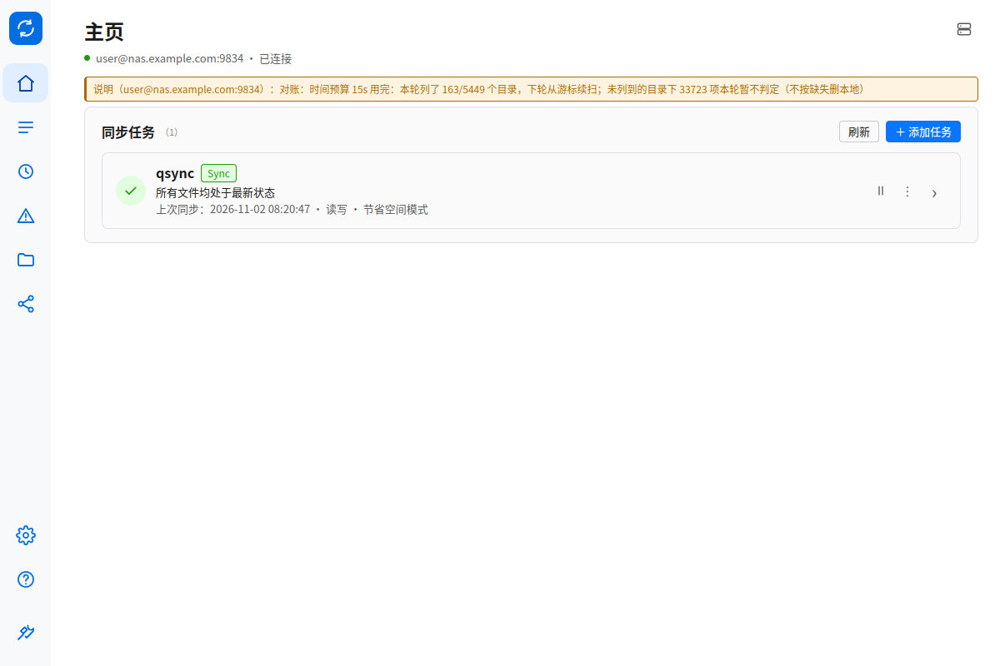
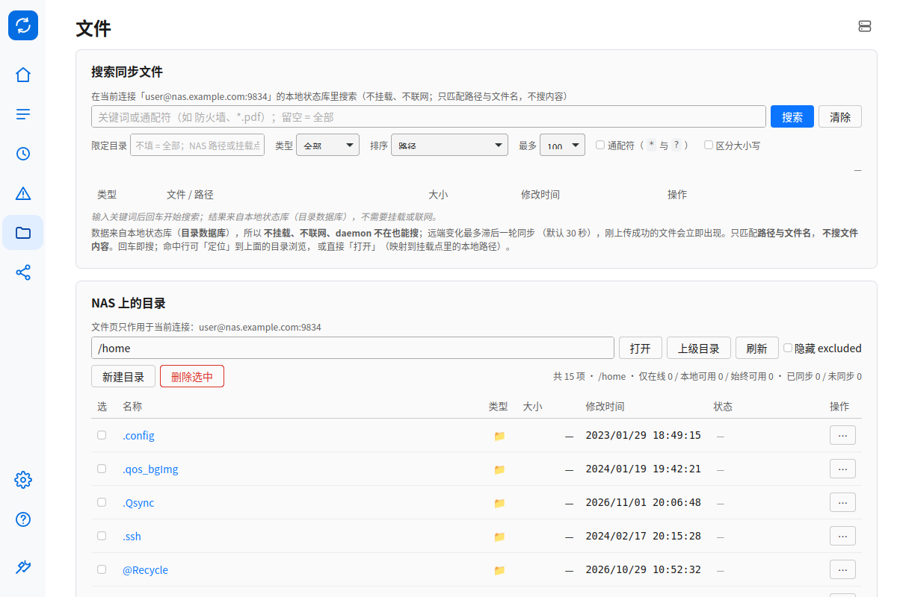
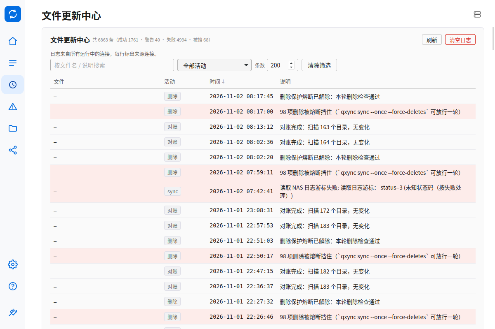
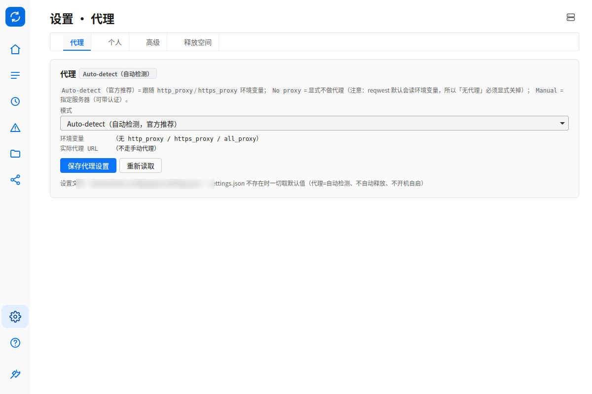

# v0.9.1 —— 截图与历史脱敏修复（安全版）

> 发布日期：2026-11-02
> 上一版：[v0.9.0](发布说明-v0.9.0.md)（桌面界面全面贴合 Qsync Client 6）

## 一句话

```text
这是一次安全修复版本，没有新功能：
  → 发布页面/仓库截图里的真实 NAS 地址（用户名@DDNS域名:端口）与本机路径已全部脱敏
  → README 四张截图按新界面重拍，地址换成占位值
  → git 历史（自 v0.7.0 起的 13 个提交、19 个 tag）里的同一批字符串一并清洗
```

## 出了什么事

v0.9.0 的发布说明直接嵌入了验收截图，顶栏连接行里的 `用户名@DDNS域名:端口` 和
设置页里的家目录路径**原样可见**——任何人打开 Release 页、或浏览仓库里的
`docs/` 都能看到。这是我的失误：早期发布清单里写过「截图已涂抹」，但之后每次发版
都没有强制执行这一条，于是约定变成了摆设。

**泄露的内容**：主机名（DDNS 域名）、用户名、家目录路径。
**没有泄露**：口令、凭据文件、TOTP 密钥 —— 已核对 `credentials*.json` 始终在
`.gitignore` 内，全部历史里不存在任何凭据文件。

## 这次改了什么

| 面 | 处理 |
|---|---|
| 入库截图（40 张） | OCR 定位敏感串后脱敏；发布说明里的 4 张嵌图加 `?v=2` 破除 camo 缓存 |
| 文档 / 测试夹具 | 真实主机名 → `nas.example.com`，用户名 → `user`，家目录 → `/home/user` |
| README 四张截图 | 用**占位配置**重拍（`user@nas.example.com`），不再靠涂抹；本机路径做模糊 |
| git 历史 | 13 个提交、19 个 tag 全量重写；文本与**截图像素**都处理（只替换文本等于只挡一半，`git log` 翻到旧提交照样看得见） |
| 发版闸门 | 新增 `xtask/release/redact-shots.py`（`--dry-run` 命中即退出码 1）与 `scrub-history.sh`（默认只演练），发布清单补 §3.0 |

## 你需要知道的

1. **历史被重写了**：所有提交 hash 都变了，`v0.7.0`–`v0.9.0` 共 19 个 tag 已强制更新。
   如果你本地有克隆，请重新 `git fetch --all --force`（或直接重新 clone），
   不要把旧 clone 上的提交推回来。
2. **旧对象仍可能残留**：force-push 不会删除 GitHub 服务器上的旧对象，
   知道旧 SHA 的人仍可能直达。彻底清除需要联系 GitHub Support。
3. **如果真的担心**：那个 DDNS 域名如果还在用，换一个最省事——历史里那个旧域名
   （即使被翻到）就指向不到你了。

## 验证

```text
git grep（全历史，敏感串）        → 0 命中
OCR 闸门（全部入库 PNG）          → 0 命中
README 四张截图                   → 重拍 + 人工核对
cargo check --workspace           → 通过
check-version.py v0.9.1           → 六处一致
```

历史清洗的备份留在本地：`git bundle` 形式的 `pre-scrub.bundle`（不入库）。

## 升级

```bash
# Arch
sudo pacman -U qxync-bin-0.9.1-1-x86_64.pkg.tar.zst
# Debian / Ubuntu
sudo apt install ./qxync_0.9.1-1_amd64.deb
```

无数据格式变更、无配置变更，纯脱敏 + 文档；`0.9.0 → 0.9.1` 直接覆盖安装即可。

## 界面截图（已脱敏）

| 主页 | 文件 |
|---|---|
|  |  |

| 文件更新中心 | 设置 · 代理 |
|---|---|
|  |  |
