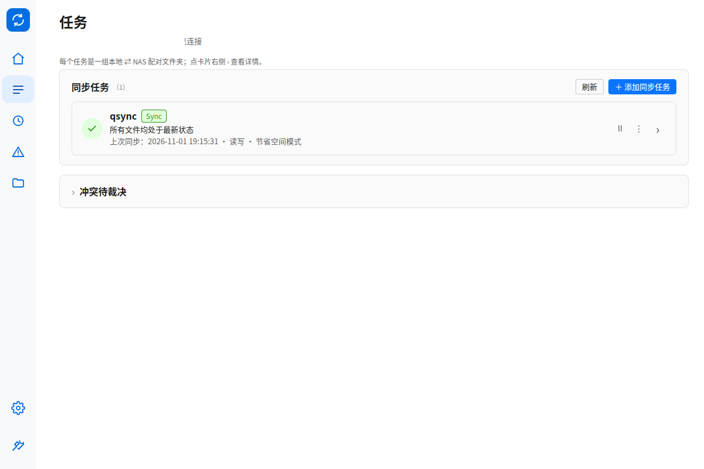
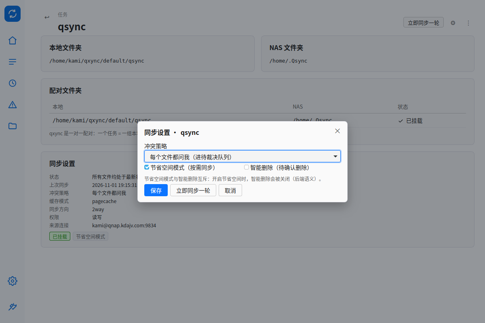
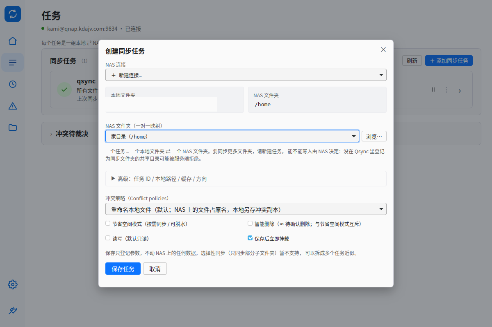
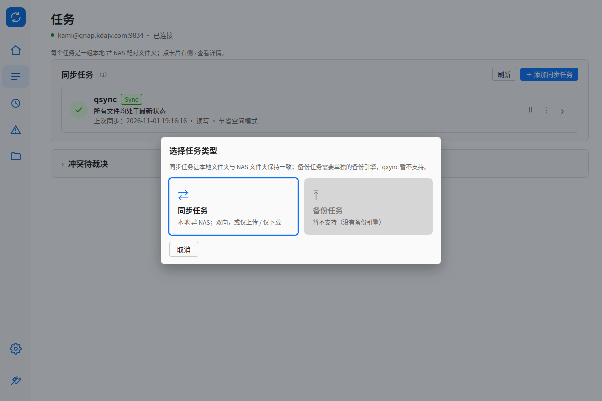

# Qsync 6 贴合验收 · 96dpi 截图基线

> 用途：P0（视觉地基 + 外壳净化）做完后，给后续 P1/P2/P3 和最终并排验收一个**可复现的 1× 基线**。
> 之前 `.local-run/gui-shots/*.png` 是 `Xft.dpi=158` 下截的（实际 DPR ≈1.6458，CSS 视口只有
> 729×486），61px 左栏量出来是 100px，**不能当几何基线**。本目录的图统一按 96dpi 出。

## 1. 怎么复现

```bash
# 仓库根目录
xtask/tests/gui-matrix.sh
```

脚本会读当前 X 资源里的 `Xft.dpi`，自动换算 `GDK_DPI_SCALE=96/dpi`（本机 158 → 0.607595），
然后照常跑 9 个目的地 + 8 个设置分区 + 旧深链兼容截图。日志里会有一行：

```
ℹ️  Xft.dpi=158 → GDK_DPI_SCALE=0.607595（截图按 96dpi 基线）
```

产物在 `.local-run/gui-shots/`（gitignore）。本目录只收**验收用的关键帧**。

手动只截一张：

```bash
GDK_SCALE=1 GDK_DPI_SCALE=0.607595 GDK_BACKEND=x11 \
QXNYC_GUI_TAB=home target/debug/qxync-gui    # 窗口 1200×800
```

## 2. 基线数值（1× 实测）

| 项 | 值 | 判定方式 |
|---|---|---|
| 窗口 | 1200×800 | `xdotool getwindowgeometry` / `identify` |
| 左栏宽 | **61px** | 截图 y=400 扫到第一列纯白（`#FFFFFF`）的 x |
| 品牌标 | 40×40，圆角 10 | `#rail-icon` 底 + 自绘双箭头 SVG，`aria-hidden` |
| 导航图标 | 24×24，stroke 1.8 | `.rail-item svg` |
| 选中胶囊 | 55×47，`#E1EEFF`，图标 `#0444A7` | `.rail-item.active` |
| 页面标题 | 24px / 600 | `.pagetitle`；左上角与内容左缘对齐（x=40） |
| 正文 / 表格 | 14 / 13.5，行高 34 | `body` / `table.tbl td` |
| 卡片 | `#FAFAFA` + 1px `#DFDFE8` + 圆角 8 + **无投影** | `.card` |
| 主按钮 | `#0C75FF`，高 30，圆角 4 | `button.primary` |
| 页面底 | 纯白 `#FFFFFF` | `--bg` |

以上 8 条中可静态判的部分已钉进 `qxync-gui --self-test` 的 `ui_spec.qs6_fit`（10 个布尔），
改回旧壳会直接红：61px 栏、选中胶囊 token、40×40 品牌 SVG、左下分组、标签默认隐藏+开关、
24px 标题、安静连接行、顶栏拆解（`chip-conn` 不存在 + 诊断有 `diag-runtime`）、日志默认 `hidden`。

## 3. 关键帧

| 文件 | 内容 | 看什么 |
|---|---|---|
| `01-home.png` | 主页 | 61px 纯图标栏、40×40 品牌标、24px 标题、`● user@host · 已连接` 安静连接行、无 daemon 药丸/pid/socket、无日志抽屉 |
| `02-tasks.png` | 任务 | 同一外壳 + 选中「任务」胶囊；内容仍是 P0 前的卡片（P1 重做） |
| `03-diag-status.png` | 诊断 → 状态 | 原顶栏工程信息落位：「运行控制」卡（启停/登录/当前连接/pid·uptime·socket·session）+「操作日志」入口；普通页不再出现这些 |
| `04-settings-personal.png` | 设置 → 个人 | 「显示导航文字」开关（默认关，P0-05） |
| `05-rail-labels-on.png` | 左栏开文字 | 96px 栏 + 图标下 10.5px 标签（开发期强制 `body.rail-labels` 截图，等于把设置开关打开） |

> 官方 vs qxync 并排图（P3-12）在 P1/P2 完成后产出，避免现在做一版必然过期的对比。

## 4. 与官方 6.x 的已知差异（有意保留）

1. 内容组 **5 个**图标（主页/任务/更新/错误/文件），官方是 4 个（Task/File Update/Error/Sharing）
   —— qxync 多了「主页」「文件」两个自有目的地；分享中心是 P3-01 占位，帮助是 P3-02。
2. 左栏文字**默认视觉隐藏**（读屏与 tooltip 保留），官方纯图标；「显示导航文字」是可发现性兜底（D2）。
3. 顶栏只有标题 + 连接行，**右上操作区**（Add/齿轮）随 P1 任务页重做再加；当前「添加任务 / 刷新」仍在卡片里。
4. 日志抽屉默认 `hidden`，入口在诊断页；官方没有这个抽屉，能力（200 条）完整保留。
5. 字体用系统 CJK 栈（Noto Sans CJK SC 等），不引入官方字体文件（D1 产品级贴合，不做像素复刻）。
6. 连接行固定显示在主页/任务页；多连接切换暂时收在诊断「运行控制」，P2-10 再做右上连接菜单。

## 5. 验收记录

- `cargo build -p qxync-gui`：通过。
- `qxync-gui --self-test`：`ok=true`；`ui_spec.ok=true`（含新增 `qs6_fit` 10/10）；i18n `zh_keys=496`、`en_keys=49`、无缺失 key。
- `xtask/tests/gui-matrix.sh`（自动 96dpi）：**160/160 通过**，含 9 目的地 + 8 设置分区 + 5 个旧深链落点等价 + 键盘 Tab 焦点环。
- 复核日期：2026-11-01；构建：`target/debug/qxync-gui`（v0.8.3 工作树）。

## P1 任务模型（2026-11-01）

复现命令同 P0（`GDK_DPI_SCALE=96/Xft.dpi`、1200×800）；详情页与模态可用深链：

```bash
QXNYC_GUI_TAB='task:qsync'       # 直接进任务详情（任务列表到齐后打开）
QXNYC_GUI_TAB='task:qsync:sync'  # 详情 + 同步设置弹窗
QXNYC_GUI_TAB='add'              # 创建同步任务表单（模态）
QXNYC_GUI_TAB='type'             # 任务类型向导
```

| 图 | 页面 | 说明 |
|---|---|---|
|  | 主页（Task List） | 一张平铺任务卡：左状态图标、`qsync` 16/700、`Sync` 角标、上次同步绝对时间、右侧暂停/⋮/›；单连接不出分组标题 |
|  | 任务 | 同形态平铺列表；冲突裁决折叠到列表下方（`details`，默认收起） |
|  | 任务详情（二级页） | `↩ 任务` 面包屑 + 标题；本地/NAS 双卡、配对文件夹表（一对一）、同步设置键值、状态徽标 |
|  | 同步设置 | 冲突策略（5 种）/节省空间/智能删除 + 立即同步一轮；节省空间与智能删除互斥有说明 |
|  | 创建同步任务 | 模态表单：本地⇄NAS 只读摘要、NAS 选择、冲突策略可见；ID/路径/缓存/方向收进「高级」折叠 |
|  | 选择任务类型 | 同步任务可选；备份任务置灰并说明「没有备份引擎」，不假装支持 |

验收：`gui-matrix.sh` 160/160；`qxync-gui --self-test` 的 `ui_spec` 全绿（i18n/空态/无障碍/purge 接线）。
