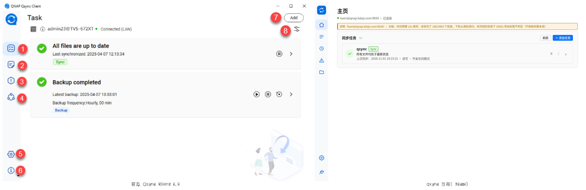
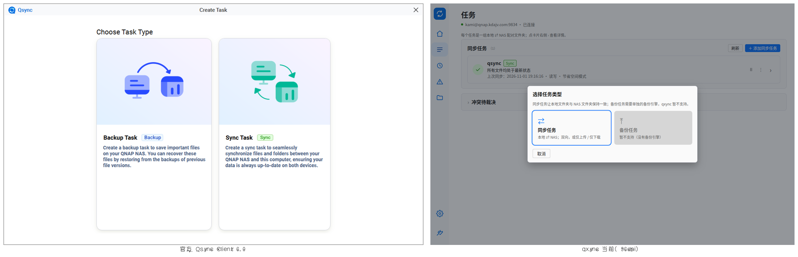
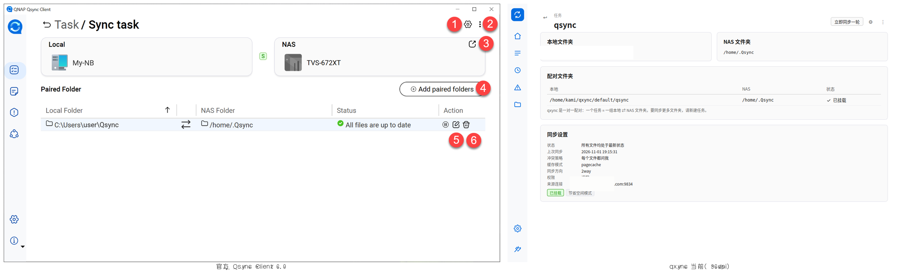
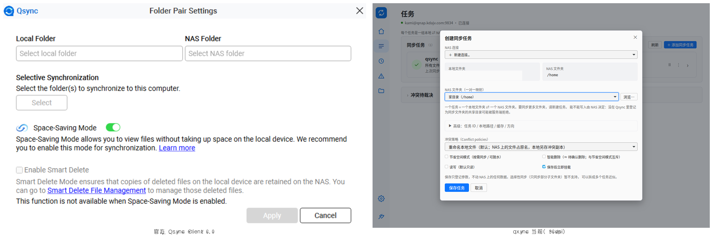
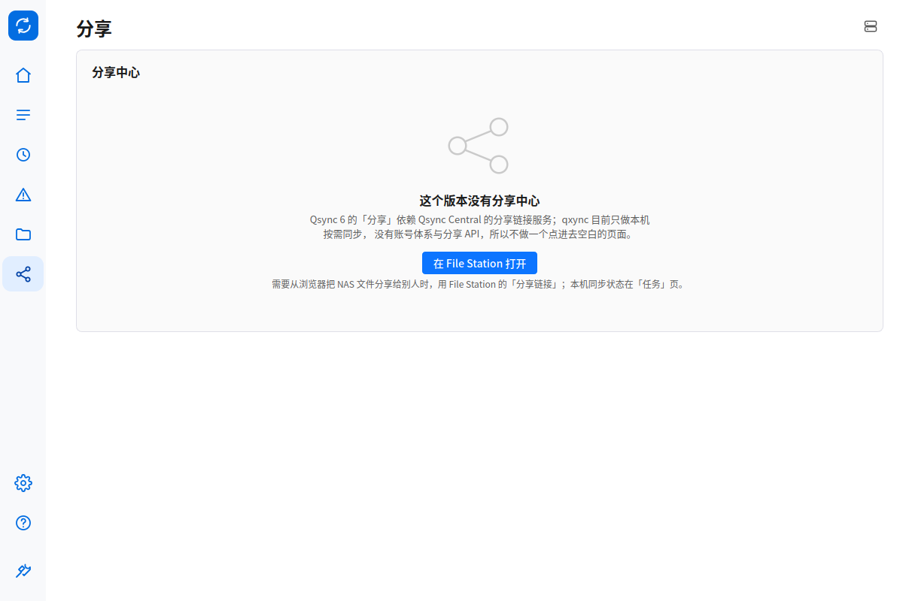
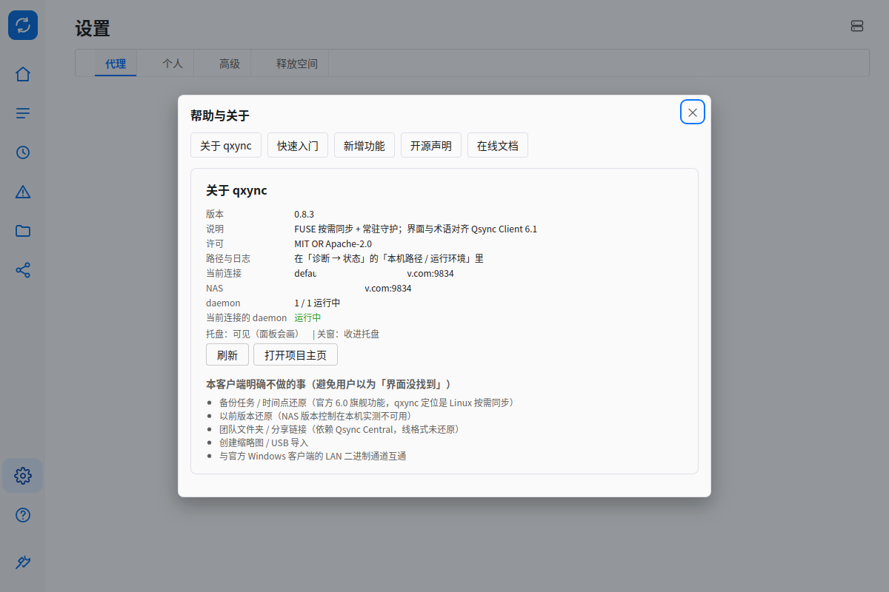
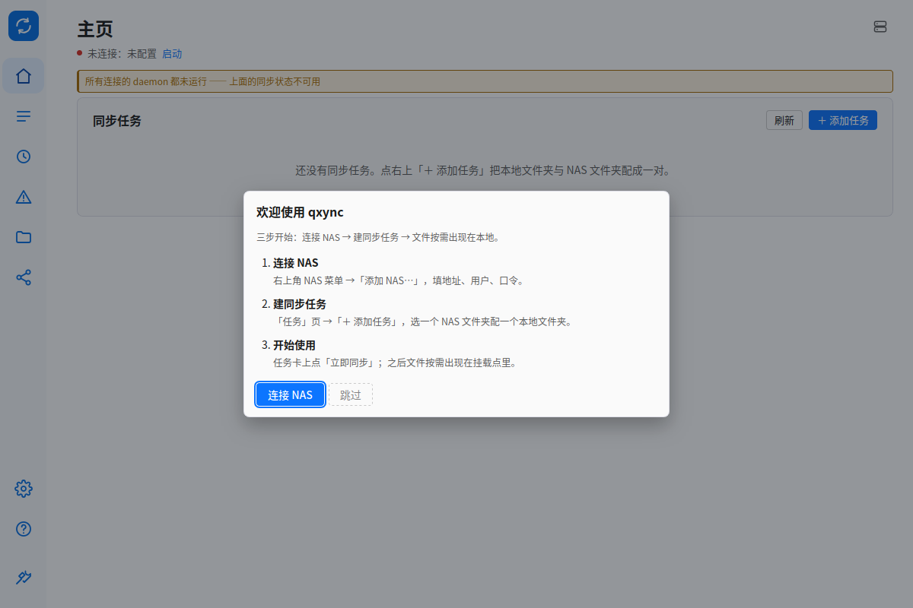

# 官方 Qsync Client 6 与 qxync 当前界面并排验收（P3-12）

- 官方一侧：`.research/shots/`（官方教程内嵌 1× 截图，`official-ui.md` §0.2 有索引与缩放标定）。
- qxync 一侧：本机 X11、`GDK_DPI_SCALE=96/158`、窗口 1200×800，复现命令见 [README](README.md)。
- 判定口径：D1「产品级贴合」——版式、层级、信息密度、术语与交互位置对齐；不做像素复刻、不抄官方图标/插图。
- 合成方式：ImageMagick 等高 700px 并排，标签「官方 / qxync 当前」。

## 1. 主页 / Task List

| 维度 | 官方 6.0 | qxync 当前 | 判定 |
|---|---|---|---|
| 左栏 | 纯图标 6 个（任务/更新/错误/分享/设置/关于） | 纯图标：主页/任务/更新/错误/文件/分享 + 设置/帮助/诊断 | 位置与形态对齐；条目按 qxync 能力扩展 ✅ |
| 顶栏 | 页标题 `Task` + `Add` 按钮 + 连接行（主机名 · Connected） | 页标题「主页」+ 安静连接行（主机 · 已连接）；卡片头有「＋ 添加任务」 | 对齐；`Add` 入口在卡片头（P1 决策）⚪ |
| 任务卡 | 状态圆勾 + 标题 + 上次同步 + `Sync` 角标 + 暂停/› | 同左，另有 ⋮ 菜单 | ✅（多 ⋮ 是有意的 discoverability） |
| 空态插图 | 官方人物插画 | 自绘线性 SVG | 不抄素材 ✅ |
| 本机差异 | — | 顶部说明条（daemon 本轮时间预算用尽） | 运行信息，非版式差异 ⚪ |

## 2. 选择任务类型（Create Task）

| 官方 | qxync |
|---|---|
| 两张大卡：Create Sync Task / Create Backup Task，均可选 | 同步任务可选；备份任务置灰并说明「没有备份引擎」 |

判定：✅ 版式同构；能力差异显式化，不假装支持（NO-11 决策）。

## 3. 同步任务详情（Task / Sync task）

| 官方 | qxync |
|---|---|
| 任务页：状态块 + `Sync` 类型 + 本地/NAS 双列文件夹信息 + 齿轮/⋮/外链 | 二级详情页：`↩ 任务` + 标题 + 本地/NAS 双卡 + 一对一文件夹对表 + 同步设置键值 + 齿轮/⋮ |
| 齿轮打开 Folder Pair Settings | 齿轮打开「同步设置」弹窗；pair 表常驻可见 |

判定：✅ 信息完整、层级同构；详情做成页面而非弹窗（P1 偏差 1，避免嵌套弹窗）。

## 4. 设置（Settings）

| 官方 | qxync |
|---|---|
| 顶部 4 个 tab：代理 / 个人 / 高级 / 释放空间；右上 NAS 图标菜单 | 同 4 tab；右上 NAS 图标菜单（添加 / 管理 / 连接测试） |
| 高级：调试日志、日志清理/发送、桌面通知、自动更新、LAN | 同位置：调试日志、日志清理/打开目录、桌面通知、自动更新（置灰说明）、LAN 设置入口 |

判定：✅ 结构与术语对齐；「发送日志」改为「打开日志目录」（无上传通道，不造假）；自动更新置灰（无更新通道）。

## 5. 文件夹对设置 / 创建同步任务

| 官方 | qxync |
|---|---|
| Folder Pair Settings：本地文件夹 / NAS 文件夹两栏 + 冲突策略 | 创建任务模态：本地⇄NAS 只读摘要 + NAS 选择 + 冲突策略；ID/路径/缓存/方向收进「高级」折叠 |

判定：✅ 语义与字段对齐；不单做 pair-settings 弹窗（P1 偏差 4：与应用级设置合并，不丢能力）。

## 6. 分享 / 帮助 / 首次引导（官方有、qxync 诚实占位或补齐）

| 图 | 说明 |
|---|---|
|  | 官方第 4 个内容图标「分享」；qxync 无 Qsync Central 分享 API → 一句说明 + File Station 深链 |
|  | 左栏 ⓘ：关于 / 快速入门 / 新增功能 / 开源声明 / 在线文档；关于页只留版本/许可/运行概览（路径类信息在诊断） |
|  | 无连接的新用户首次启动三步引导（连接 NAS → 建任务 → 开始使用），可跳过 |

## 7. 保留差异（有意，不追平）

1. **内容组 6 个图标**（主页/任务/更新/错误/文件/分享）：官方 4 个；qxync 多主页与文件两个自有目的地，分享为占位。
2. **关于/诊断分离**：官方 Help/About 简单；qxync 把 socket/配置目录/运行控制等排障信息放「诊断」，普通页面不出现。
3. **备份/恢复/版本/缩略图/USB 不做**：官方 6.0 旗舰能力，qxync 定位 Linux 按需同步（NO 决策）。
4. **智能删除语义不同**：官方 Smart Delete 删除 NAS 副本；qxync 只做「待确认删除」保护（不照抄危险默认）。
5. **LAN 同步**：qxync 自研协议，与官方 Windows 客户端二进制通道不互通（NO/BE 决策）。
6. **字体/图标**：系统 CJK 字体 + 自绘线性图标，不引入官方素材（D1）。

## 8. 验收汇总

- `cargo build -p qxync-gui`：通过。
- `qxync-gui --self-test`：`ok=true`，`ui_spec.ok=true`，i18n 无缺失 key。
- `xtask/tests/gui-matrix.sh`（自动 96dpi）：**165/165**（含新增「分享」目的地）。
- `xtask/tests/gui-purge.sh`：**37/37**。
- 截图目录：`p0/`（P0 基线）、`p1/`（任务模型）、`p2/`（信息架构）、`p3/`（打磨与并排）。

> 生成日期 2026-11-01；官方素材版权归 QNAP，仅作本地比对，不随代码分发。
